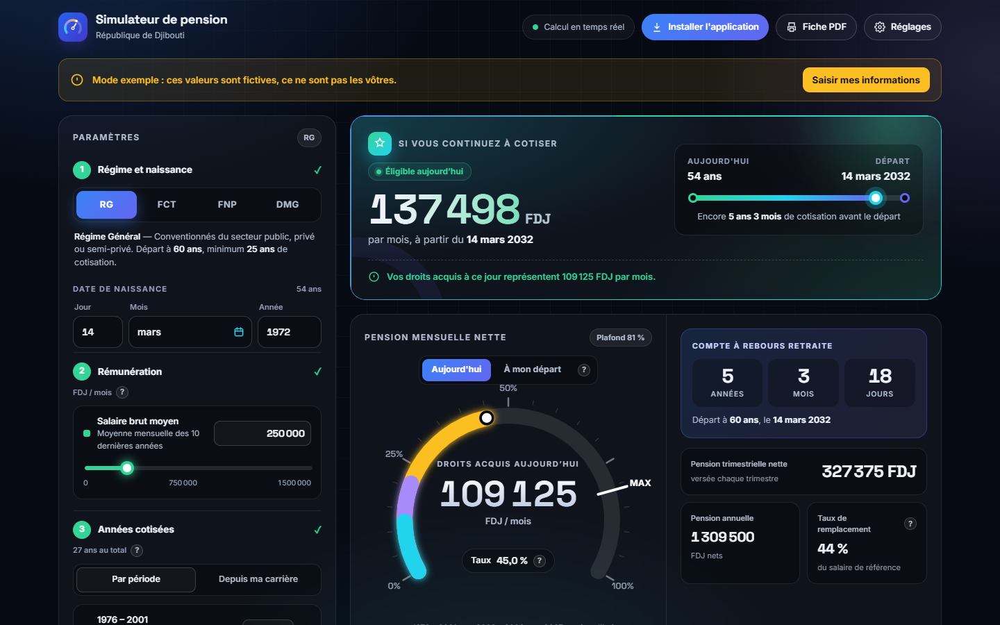
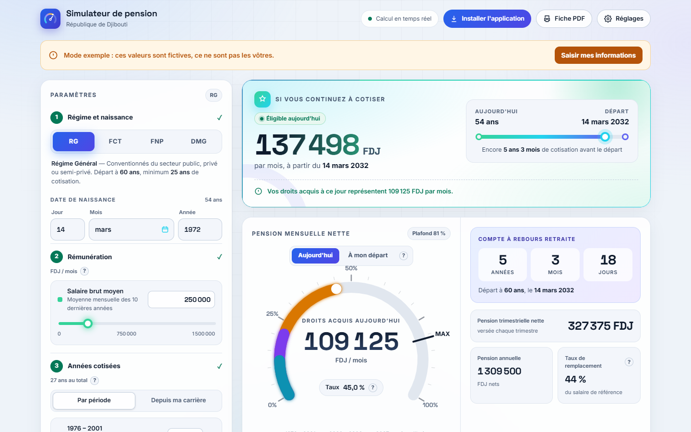
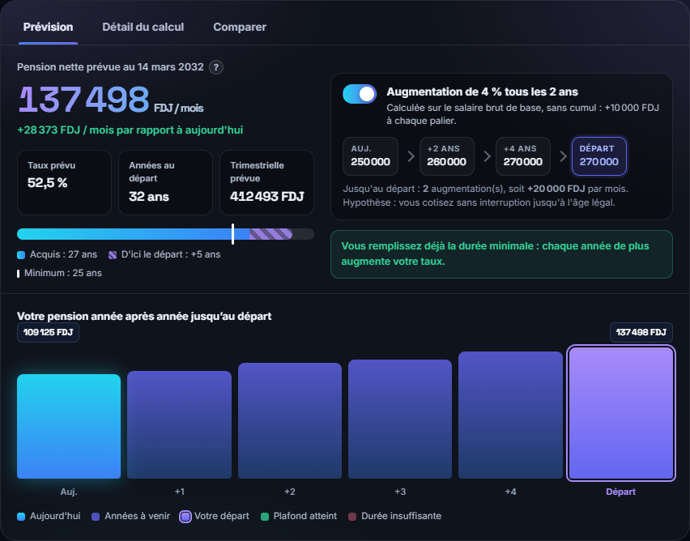
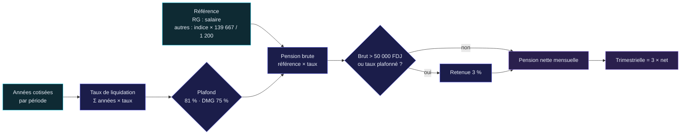

<div align="center">

<picture>
  <source media="(prefers-color-scheme: dark)" srcset="docs/banner-dark.svg">
  <source media="(prefers-color-scheme: light)" srcset="docs/banner-light.svg">
  
</picture>

<br>


<br><br>

**[Aperçu](#-aperçu)** &nbsp;·&nbsp;
**[Fonctionnalités](#-fonctionnalités)** &nbsp;·&nbsp;
**[Règles de calcul](#-règles-de-calcul)** &nbsp;·&nbsp;
**[Démarrage](#-démarrage-rapide)** &nbsp;·&nbsp;
**[Paramètres de loi](#-modifier-un-paramètre-de-loi)** &nbsp;·&nbsp;
**[Mise en ligne](#-mise-en-ligne)**

</div>


Simulateur web de **pension normale de retraite** pour les quatre régimes de retraite de Djibouti : **RG**, **FCT**, **FNP** et **DMG**.
Il affiche en temps réel la pension acquise aujourd'hui, celle prévue à l'âge légal de départ et le détail complet du calcul.

> [!NOTE]
> Tout fonctionne **dans le navigateur** : aucune donnée personnelle n'est envoyée à un serveur.
> La saisie est seulement mémorisée sur l'appareil de l'utilisateur.


## ✦ Aperçu

<p align="center">
  
</p>

<table>
  <tr>
    <td width="40%" align="center" valign="top">
      <br>
      <sub><b>Thème clair</b> · choisi automatiquement ou manuellement</sub>
    </td>
    <td width="38%" align="center" valign="top">
      <br>
      <sub><b>Prévision</b> · pension année après année jusqu'au départ</sub>
    </td>
    <td width="22%" align="center" valign="top">
      <br>
      <sub><b>Mobile</b> · installable comme une application</sub>
    </td>
  </tr>
</table>


## ✦ Fonctionnalités

<table>
  <tr>
    <td width="33%" valign="top">
      <h3>🎯 Jauge en temps réel</h3>
      Pension nette mensuelle, trimestrielle et annuelle, taux de liquidation et taux de remplacement, recalculés à chaque saisie.
    </td>
    <td width="33%" valign="top">
      <h3>🔮 Prévision au départ</h3>
      Montant attendu à l'âge légal, même si la durée minimale n'est pas encore atteinte, avec compte à rebours jusqu'au départ.
    </td>
    <td width="33%" valign="top">
      <h3>📈 Évolution du salaire</h3>
      RG : <b>+4 % du salaire brut de base tous les 2 ans</b>, sans cumul. Autres régimes : évolution de l'indice réglable.
    </td>
  </tr>
  <tr>
    <td valign="top">
      <h3>🧭 Carrière automatique</h3>
      Les années par période sont calculées à partir des dates de début et de fin, interruptions déduites.
    </td>
    <td valign="top">
      <h3>🧮 Détail du calcul</h3>
      Référence → brut → retenue → net, période par période, pour vérifier chaque montant.
    </td>
    <td valign="top">
      <h3>⚖️ Comparaison</h3>
      Jusqu'à 4 scénarios côte à côte, aujourd'hui et au départ.
    </td>
  </tr>
  <tr>
    <td valign="top">
      <h3>🖨️ Fiche PDF</h3>
      Récapitulatif imprimable, prêt à joindre à un dossier.
    </td>
    <td valign="top">
      <h3>📱 Installable &amp; hors ligne</h3>
      Application web progressive : s'installe sur téléphone et fonctionne sans connexion.
    </td>
    <td valign="top">
      <h3>♿ Accessible</h3>
      Thèmes clair et sombre, grands caractères, navigation au clavier, visite guidée, français et anglais.
    </td>
  </tr>
</table>


## ✦ Règles de calcul

| Régime | Départ | Durée min. | Plafond | Base de calcul | Taux annuels par période |
|:--|:--:|:--:|:--:|:--|:--|
| **RG**  · Régime Général | 60 ans | 25 ans | 81 % | Salaire brut moyen | 1976–2001 : **2 %** · 2002–2006 : **1,8 %** · depuis 2007 : **1,5 %** |
| **FCT** · Fonctionnaires | 60 ans | 25 ans | 81 % | Indice de solde | 1976–2001 : **3 %** les 15 premières années, puis **2 %** · 2002–2006 : **1,8 %** · 2007–2009 : **1,5 %** · depuis 2010 : **1,3 %** |
| **FNP** · Force Nationale de Police | 55 ans | 25 ans | 81 % | Indice de solde | Comme FCT (jusqu'à 6 ans sur 2002–2006) |
| **DMG** · Députés &amp; membres du Gouvernement | 60 ans | 10 ans | 75 % | Indice de solde | 1976–2001 : **4 %** · depuis 2002 : **3 %** |



> [!TIP]
> Pour FCT et FNP, les années décimales sont arrondies au trimestre. La durée minimale est contrôlée sur les années entières saisies.


## ✦ Démarrage rapide

Il faut [Node.js](https://nodejs.org) 18 ou plus récent.

```bash
npm start        # serveur local → http://localhost:8080
npm test         # tests du moteur de calcul
```

> [!NOTE]
> Ouvrir `simulateur.html` par double-clic fonctionne aussi, mais sans installation sur téléphone ni mode hors ligne :
> ces deux fonctions exigent une adresse `http://localhost` ou `https://`.

<details>
<summary><b>Structure du projet</b></summary>
<br>

```text
.
├── simulateur.html          Page principale (structure uniquement)
├── css/style.css            Apparence : thèmes clair/sombre, mobile, impression
├── js/
│   ├── config.js            ★ Paramètres de loi : point d'indice, taux, plafonds, âges…
│   ├── calcul.js            Moteur de calcul (fonctions pures, testées)
│   ├── i18n.js              Textes en français et en anglais
│   └── app.js               Interface : saisie, jauge, prévision, scénarios, fiche PDF
├── sw.js                    Cache hors ligne (PWA)
├── manifest.webmanifest     Installation sur téléphone
├── icons/                   Icônes de l'application
├── tests/calcul.test.js     Tests automatiques du calcul
├── serve.js                 Petit serveur local pour les essais
└── docs/                    Images de ce README
```

</details>


## ✦ Modifier un paramètre de loi

Tous les paramètres réglementaires sont regroupés dans **un seul fichier** : [`js/config.js`](js/config.js).

1. Modifier la valeur dans `js/config.js`, par exemple le point d'indice :
   ```js
   pointIndice: { numerateur: 139667, denominateur: 1200 }
   ```
2. Lancer `npm test`. Si un test échoue parce que la règle a volontairement changé, mettre à jour la valeur attendue dans `tests/calcul.test.js`.
3. Mettre la même nouvelle valeur dans `version` (`js/config.js`) et dans `CACHE` (`sw.js`).

> [!IMPORTANT]
> Sans l'étape 3, les téléphones qui ont installé l'application garderaient l'ancienne version.

Le seuil et le taux de la retenue, l'indice maximal, la valeur du point et l'âge minimal de travail sont repris automatiquement dans les textes affichés.

<details>
<summary><b>Évolution du salaire RG</b></summary>
<br>

L'augmentation utilisée par la prévision se règle dans :

```js
regimes.RG.evolution: { taux: 0.04, tousLesAnnees: 2 }
```

Elle est calculée sur le **salaire brut de base**, sans cumul :

| Aujourd'hui | + 2 ans | + 4 ans | + 6 ans |
|:--:|:--:|:--:|:--:|
| 168 500 | 175 240 | 181 980 | 188 720 |

</details>


## ✦ Tests

| Vérification | Détail |
|:--|:--|
| ✅ Cas calculés à la main | Chaque régime : retenue, plafond, palier FCT, arrondi au trimestre, durée minimale |
| ✅ Non-régression | Mêmes montants que **l'ancien simulateur**, à 1 FDJ près, sur **12 000** saisies aléatoires |
| ✅ Dates | Âge de départ, limites d'années selon l'âge, compte à rebours |
| ✅ Carrière | Calcul automatique des années à partir des dates, interruptions comprises |
| ✅ Prévision | Années ajoutées jusqu'au départ, évolution du salaire RG |


## ✦ Mise en ligne

Copier tout le dossier sur le serveur web, en **HTTPS** pour que l'installation sur téléphone fonctionne.
Seuls `tests/`, `docs/`, `serve.js`, `package.json` et ce fichier peuvent être omis.

## ✦ Traductions

Les textes sont dans [`js/i18n.js`](js/i18n.js) (français et anglais). Une clé absente en anglais s'affiche en français.
Pour ajouter une langue, copier le bloc `STR.en`, le traduire et l'ajouter à la liste `LANGS`.

<br>


<div align="center">
<sub><b>Simulateur de pension</b> · République de Djibouti</sub><br>
<sub>Projet indépendant et non officiel. Les montants affichés sont une estimation et n'ont pas de valeur contractuelle.</sub>
</div>
